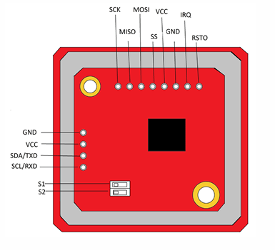
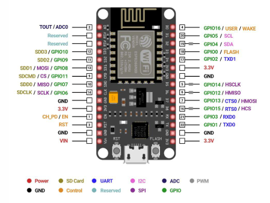
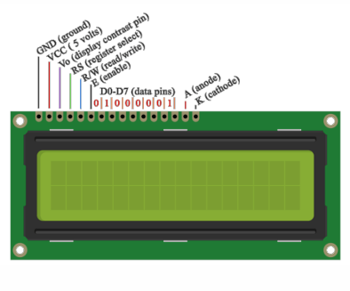

# Penn-State-ID-Card-Reader
### Description
The focus of this project was to eliminate the need for manual paper writing sign-in sheets at Penn State Hazleton. The steps to accomplish this goal involved using a programmable microcontroller, along with a method of displaying scanned data and database collection. This of course was to mimic a potential long-term solution to the problem and demonstrate what's possible
### Materials
+ **Arduino Uno**: Microcontroller
+ **QAPASS 1602A 16x2 LCD Display**: Display Scanned Data
+ **ESP8266MOD**: Allow Connection to the Internet
+ **PN532 13.56MHz NFC/RFID Controller Breakout Board**: Scanner
+ **Potentiometer**: Control of the Contrast of the Display Screen
+ **220Ω Resistor**: Provides Appropriate Voltage to Display Screen
+ **1kΩ & 2kΩ Resistors**: Provides proper voltage to the ESP8266
+ **Bread Board**: Hosts all components and wiring
### Components
+ **PN532**
  + Uses radio waves to wirelessly communicate, also known as a RFID (Radio Frequency Identification Reader)
  + Supports devices with protocol ISO/IEC 1443 (The International Standard for Contactless Smart Cards and Near Field Communication Devices)

+ **ESP8266**
  + Standalone microcontroller but used as Wi-Fi access for the purposes of this research as the Arduino Uno lacks such capability
  + Exchanges data with the Arduino Uno using RX(Receiving) and TX(Transmitting) pins

+ **QAPASS 1602A**
  + Receives character data and commands via a 4-bit or 8-bt parallel interface
  + Can display symbols and letters, along with possessing a cursor for modifying
  + Receives card information and displays them appropriately

### Disclaimer
The UID of a Penn State ID card was possible to display, but other data such as name and ID number were inaccessible. This was because such data is locked within Penn State University’s database, and to access this data, possession of the encryption key to gain entry to the database is required. However, doing so is out of reach and highly confidential  
Furthermore, the original plan of data collection using the ESP8266 was never able to be fully implemented due to time constrictions of the project

